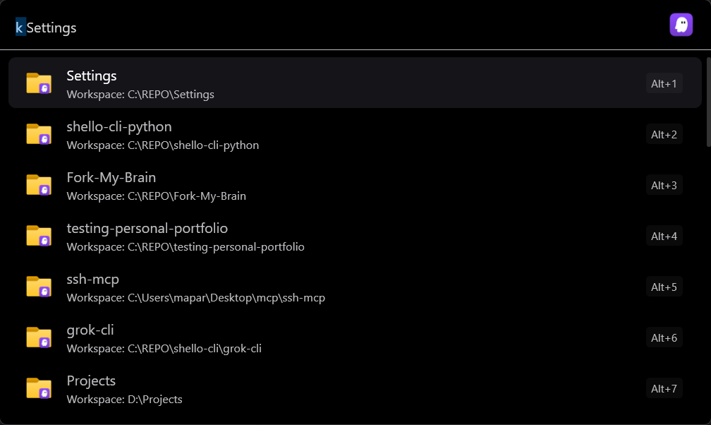
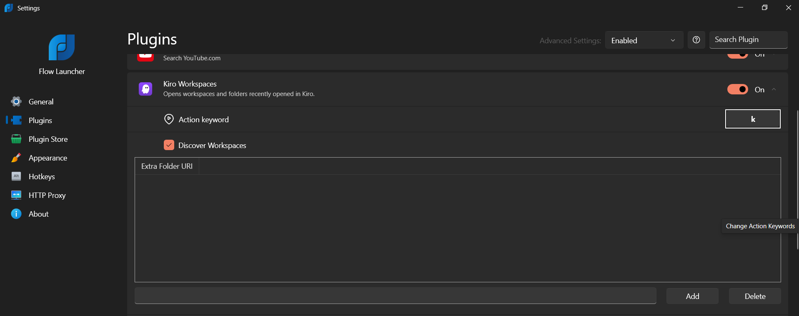
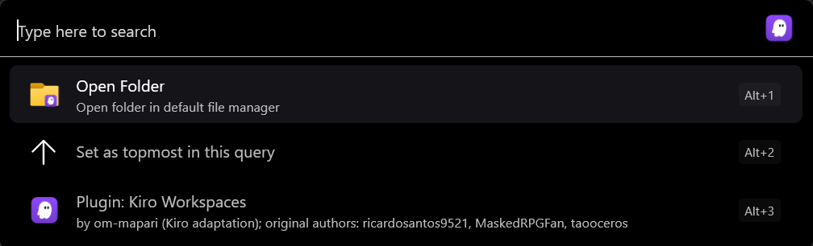

# Flow.Plugin.KiroWorkspace

A [Flow Launcher](https://www.flowlauncher.com/) plugin that lists the workspaces and folders you recently opened in
[Kiro](https://kiro.dev/) and opens them with a few keystrokes.

[](https://github.com/om-mapari/Flow.Plugin.KiroWorkspace/actions/workflows/build.yml)

Type the action keyword `k`, then part of a folder name, and press Enter.

## Features

- Lists the folders and `.code-workspace` files from Kiro's recently opened list.
- Fuzzy matching on the folder name, using Flow Launcher's own search.
- Enter opens the workspace in Kiro.
- Ctrl+Enter, or the context menu, opens a local folder in the file manager.
- Extra folders can be added in the plugin settings, and automatic discovery can be switched off.
- Shows a clear message if Kiro cannot be found, if the Kiro executable was moved, or if a local folder no longer exists.

## Screenshots

<!--
TODO (maintainer): add real screenshots, then remove the "coming soon" lines and uncomment the image links.
Expected files (not created yet; the docs/images folder does not exist):
  docs/images/search.png        Flow Launcher with `k` typed and a list of recent Kiro workspaces.
  docs/images/settings.png      Flow Settings > Plugins > Kiro Workspaces, showing the settings panel.
  docs/images/context-menu.png  The context menu of a workspace result showing "Open Folder".
-->

Search results:

_Screenshot coming soon_
<!--  -->

Plugin settings:

_Screenshot coming soon_
<!--  -->

Context menu:

_Screenshot coming soon_
<!--  -->

## Requirements

- Windows x64 with Flow Launcher installed.
- Kiro installed. The plugin looks for `Kiro.exe` on `PATH`, then in `%LOCALAPPDATA%\Programs\Kiro`, then in
  `%ProgramFiles%\Kiro` (see [How it works](#how-it-works)).
- No .NET SDK is needed to use the plugin. The package is framework-dependent and targets `net7.0-windows`.

## Installation

Download the plugin ZIP from the [Releases page](https://github.com/om-mapari/Flow.Plugin.KiroWorkspace/releases/latest)
(`Flow.Plugin.KiroWorkspace-<version>.zip`). Builds of unreleased changes are also available as artifacts of the **build**
workflow on the **Actions** tab.

If the plugin is listed in Flow Launcher's plugin store, you can install it from Settings > Plugin Store instead.
Until then, install it manually:
1. Close Flow Launcher.
2. Create a folder for the plugin under `%APPDATA%\FlowLauncher\Plugins\`, for example `Kiro Workspaces-0.1.0`, and
   extract the ZIP into it. `plugin.json` must sit directly inside that folder, not in a subfolder.
3. Start Flow Launcher again.

## Usage

- Type `k` to list your recent Kiro workspaces. Add part of a folder name to filter the list, for example `k myproj`.
- Press Enter to open the selected workspace in Kiro.
- Press Ctrl+Enter to open the folder in the file manager instead. This applies to local folders only. For a
  `.code-workspace` file, the folder that contains the file is opened.
- Open the context menu on a result and choose **Open Folder** for the same file manager action. The menu entry is
  shown for local workspaces only.
- To change the action keyword, go to Flow Launcher Settings > Plugins > Kiro Workspaces.

### Plugin settings

Open the settings panel from Flow Launcher Settings > Plugins > Kiro Workspaces.

- **Discover Workspaces**: when checked (the default), the plugin reads the recently opened list from Kiro. Clear it to show
  only the extra folders you add yourself.
- **Extra Folder URI**: add folders that are not in Kiro's recent list. Type a folder path or a URI in the text box and click
  **Add**. A plain path is converted to a `file:///` URI. Select entries and click **Delete** to remove them.

## How it works

Kiro is built on Code OSS and stores its recently opened list in the same way VS Code does. The plugin:

1. Finds `Kiro.exe`: first in the directories on `PATH` (a `bin` entry such as `...\Kiro\bin` maps to its parent folder), then in
   `%LOCALAPPDATA%\Programs\Kiro`, then in `%ProgramFiles%\Kiro`.
2. Reads the `history.recentlyOpenedPathsList` entry from two SQLite databases, when they exist:
   - `%APPDATA%\Kiro\User\globalStorage\state.vscdb`
   - `~\.kiro-shared\sharedStorage\state.vscdb`

   The databases are opened read-only. If one cannot be read, the error is logged and the query continues.
3. Merges the entries with your extra folders and removes duplicates.
4. Opens a selection by running `Kiro.exe --folder-uri <uri>`, or `Kiro.exe --file-uri <uri>` for `.code-workspace` files.

## Troubleshooting

**"Kiro was not found"**
The plugin could not find `Kiro.exe`. Install Kiro, or add its `bin` folder to `PATH`, then try again. The plugin checks
again on the next search, so you do not need to restart Flow Launcher after installing Kiro.

**"Kiro.exe no longer exists at the location it was found"**
Kiro was moved or uninstalled after the plugin found it. Reinstall Kiro or restore it to its previous location.

**"This path no longer exists: ..."**
The folder or workspace file from the list has been moved or deleted. Open the folder you want in Kiro once so that
it appears in the list again, or add the new location as an extra folder in the plugin settings.

**"Can't open this workspace"**
Starting Kiro failed. Details are written to the Flow Launcher log.

**The list is empty**
Check that **Discover Workspaces** is enabled in the plugin settings, and that you have opened at least one folder in Kiro.
The recent list is read from the two database files listed in [How it works](#how-it-works).

**Logs**
Flow Launcher writes its logs to `%APPDATA%\FlowLauncher\Logs`. Errors from this plugin, such as an unreadable
Kiro database or a failed launch, are logged there.

## Differences from the VS Code plugin

| Area | VS Code plugin | This plugin |
| --- | --- | --- |
| Executable | `code`, `code-insiders`, `codium` from `PATH` | `Kiro.exe` from `PATH` (`...\Kiro\bin`), then `%LOCALAPPDATA%\Programs\Kiro`, then `%ProgramFiles%\Kiro` |
| User data | `%APPDATA%\Code`, `~\.vscode-shared` | `%APPDATA%\Kiro`, `~\.kiro-shared` |
| Recent list | `history.recentlyOpenedPathsList` in `state.vscdb` (and legacy `storage.json`) | `history.recentlyOpenedPathsList` in `state.vscdb` only |
| Action keyword | `{` | `k` (so both plugins can be installed together; changeable in Flow Launcher settings) |
| SSH host list | Read from `remote.SSH.configFile` and opened with the Microsoft Remote - SSH extension | **Removed** (see below) |
| Launching | `code --folder-uri` / `--file-uri` | `Kiro.exe --folder-uri` / `--file-uri` |
| Icons | VS Code logo | Kiro's own executable icon is read at runtime; the plugin icon is the Kiro app icon (see Trademarks) |
| Translations | 17 locales | English only (the old strings described VS Code and SSH features and were not re-reviewed) |

## Verification status and known limitations

What the automated build covers: GitHub Actions restores, builds in Release, runs the 47 unit tests and packages the plugin ZIP
on every run of the **build** workflow.

What is not covered by automated tests:

- Loading the plugin inside Flow Launcher.
- Launching Kiro from the plugin.
- Which Flow Launcher versions work. No version compatibility has been verified.

A green build does not prove any of these.

Known limitations:

- **Remote workspaces are unverified.** Recent entries that use the `vscode-remote://` scheme (SSH, WSL, Dev Containers) are
  parsed, listed and passed to Kiro with `--folder-uri`. Whether Kiro stores such entries and can reopen them depends on the
  remote extension you have installed. This has not been tested against any remote setup. For these entries, the file manager
  actions are not offered.
- **Portable layouts are unverified.** A `data` folder next to `Kiro.exe` is supported in code, carried over from VS Code's
  layout, but has not been tested.
- **SSH host discovery was removed.** The VS Code plugin read hosts from an SSH config file and relied on Microsoft's Remote - SSH
  extension. That cannot be assumed for Kiro.
- **English only.**
- **Where the checks were made.** The storage locations and the `--folder-uri` / `--file-uri` options were checked by the
  maintainer on one Windows machine with Kiro 1.1.70 installed.

## Building

Builds run only in GitHub Actions. Releases are created by [`.github/workflows/release.yml`](.github/workflows/release.yml) when a `v<version>` tag is pushed; the tag must match the `Version` in `plugin.json`. Everyday builds use [`.github/workflows/build.yml`](.github/workflows/build.yml). The workflow runs on pushes to
`main` and `feat/**`, on pull requests, and manually. It restores, builds in Release for x64, runs the tests, then publishes for
`win-x64` and zips the output as the plugin package. It checks that `plugin.json`, the plugin DLL and the SQLite libraries are in the ZIP.

[`global.json`](global.json) pins .NET SDK 7.0.410 (rolling forward within the 7.0 feature bands), and the project targets
`net7.0-windows`. A local SDK is optional: if you have the .NET 7 SDK installed, you can build the same way the workflow does:

```
dotnet build Flow.Plugin.KiroWorkspace.sln -c Release -p:Platform=x64
```

## Credits and relationship to the original project

This is a fork of [taooceros/Flow.Plugin.VSCodeWorkspace](https://github.com/taooceros/Flow.Plugin.VSCodeWorkspace),
the VS Code Workspaces plugin for Flow Launcher, adapted for Kiro. The original code in turn comes from
[Microsoft PowerToys](https://github.com/microsoft/PowerToys/tree/main/src/modules/launcher/Plugins/Community.PowerToys.Run.Plugin.VSCodeWorkspaces).
Thanks to the original authors (ricardosantos9521, MaskedRPGFan, taooceros and contributors).

This project is independent. It is **not** affiliated with or endorsed by the original author, Microsoft, Kiro or Flow Launcher.
The original Git history is preserved; see `git log`.

## License

Licensed under the MIT license, see [LICENSE](LICENSE). Third-party licenses and notices are in
[THIRD_PARTY_NOTICES.md](THIRD_PARTY_NOTICES.md).

## Trademarks

The Kiro name and icon belong to their owner and are used here only to identify the application this plugin works with. Images/kiro.png is not covered by the MIT license.
